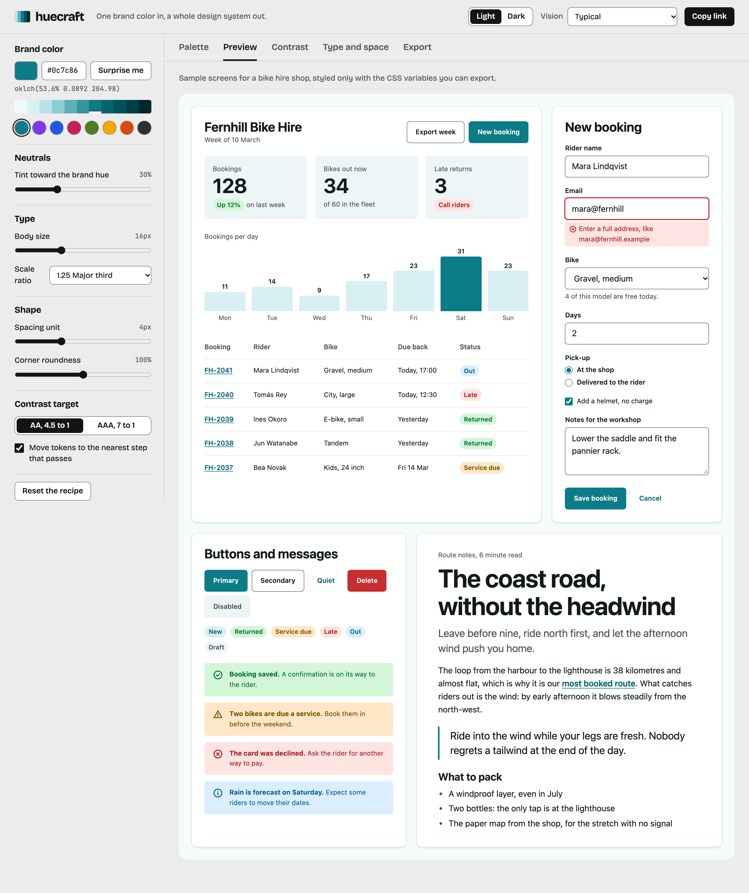
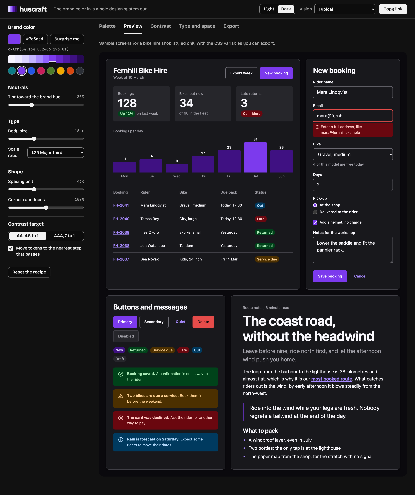
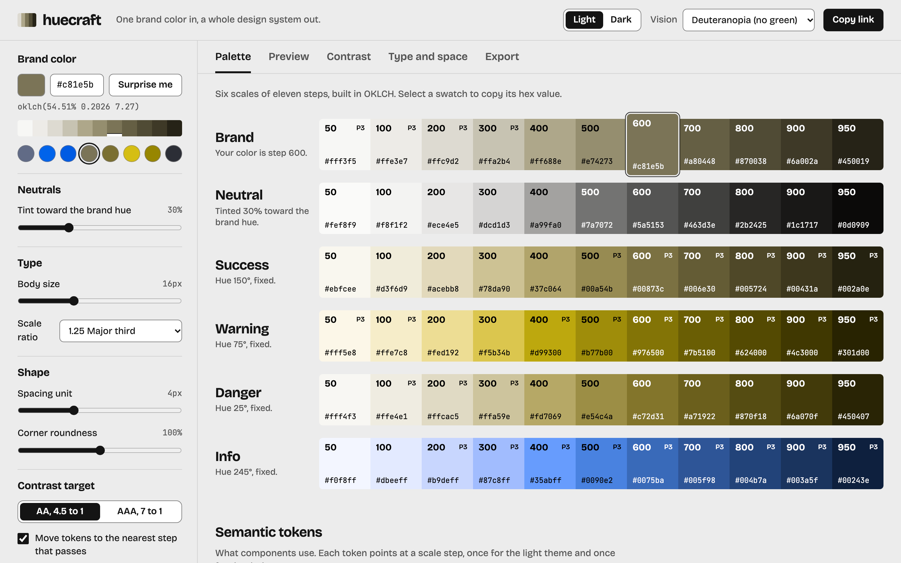

# huecraft

A design-token studio: pick one brand color and get a complete, accessible design system.
It runs in the browser, and the same generator ships as a small CLI.


## Quickstart

You need Node.js 22.18 or newer.

```bash
git clone https://github.com/Habibeyilmazz/huecraft.git
cd huecraft
npm ci
npm run dev
```

Open http://localhost:4140. Change the brand color and everything follows.

The CLI prints the same tokens to stdout:

```bash
node dist-cli/cli.js 7c3aed --format css > tokens.css     # inside the clone, after npm ci
npx github:Habibeyilmazz/huecraft 7c3aed --format tailwind  # anywhere; builds from source on first run
```

Write the color without `#`, or quote it (`'#7c3aed'`), because an unquoted `#` starts a comment in most shells.
Run `node dist-cli/cli.js --help` for every option. huecraft is not published to npm.

## What you get

- **Color scales.** Brand, neutral, success, warning, danger and info, eleven steps each (50 to 950), built in OKLCH.
  The brand scale keeps your exact color at the step nearest its lightness. Neutrals are tinted toward the brand hue
  by an amount you choose.
- **sRGB and Display P3.** Every step is gamut-mapped by lowering chroma only, so lightness and hue hold. Where P3 can
  show more chroma than sRGB, the CSS export adds an `oklch()` override inside `@media (color-gamut: p3)`.
- **Semantic tokens for light and dark themes.** Backgrounds, surfaces, borders, text, a primary role and four status
  roles, each pointing at a scale step.
- **Contrast built in.** Each token is moved to the nearest step that reaches your target (WCAG 2.2 AA or AAA for text,
  3 to 1 for fills, borders and focus rings). The Contrast tab lists every checked pair with its WCAG ratio and APCA
  Lc value, shows what was moved, and has a step-by-step matrix for any two scales. Turn the fixing off to see what
  fails and what huecraft suggests.
- **Type, space, radius and shadow scales.** A modular type scale with fluid `clamp()` sizes, a spacing scale from one
  unit, a radius scale with one roundness control, and five layered shadows per theme.
- **Live preview.** A dashboard, a table, a form with an error state, buttons, badges, alerts and an article, styled
  only by the CSS variables you export. Light and dark switch instantly.
- **Color-vision simulation.** View the whole studio as someone with protanopia, deuteranopia, tritanopia or
  achromatopsia would.
- **Exports.** CSS custom properties, a Tailwind CSS v4 `@theme`, W3C design-tokens JSON, a Figma variables payload
  and SCSS maps. Copy or download.
- **Shareable links.** The whole state lives in the URL query string. "Copy link" gives you a link that reopens the
  same palette, theme and tab.

| Light preview | Dark preview |
| --- | --- |
|  |  |

| Contrast check with fixing off | Deuteranopia simulation |
| --- | --- |
|  |  |

## CLI

```text
huecraft <color> [options]

  -f, --format <f>   css | tailwind | json | figma | scss   (default: css)
      --tint <n>     neutral tint toward the brand hue, 0..1   (default: 0.3)
      --ratio <n>    type scale ratio: 1.067, 1.125, 1.2, 1.25, 1.333, 1.414, 1.5   (default: 1.25)
      --base <px>    body text size, 14..20   (default: 16)
      --unit <px>    spacing unit, 3..6   (default: 4)
      --radius <n>   corner roundness, 0..2   (default: 1)
      --level <l>    WCAG contrast target, AA | AAA   (default: AA)
      --no-fix       keep preferred steps even where they miss the contrast target
```

Every export starts with a comment holding the command that recreates it.
Invalid input exits with code 2 and a message on stderr.

## How it works

Everything that computes tokens lives in `src/core` and has no dependencies. The web app (`src/app`) and the CLI
(`src/cli.ts`) both call it, so they cannot disagree.

| File | Job |
| --- | --- |
| `core/color.ts` | sRGB, Display P3 and OKLCH conversion, gamut mapping, WCAG 2 contrast, APCA Lc, color-vision matrices |
| `core/scales.ts` | The six 11-step scales |
| `core/semantic.ts` | Light and dark semantic tokens, the contrast walk, the list of checked pairs |
| `core/dimensions.ts` | Fluid type scale, spacing, radius |
| `core/tokens.ts` | The recipe (validated at the URL and CLI boundaries) and the full token set |
| `core/export.ts` | The five output formats |

Some decisions worth knowing:

- **One lightness curve for all chromatic scales.** Step 600 of success is about as light as step 600 of danger, so
  contrast is predictable across hues. The brand scale stretches that curve just enough to land your color exactly on
  one step.
- **Contrast by walking the scale.** Each semantic token has a preferred step. If it misses its target against the
  backgrounds it is used on, huecraft walks toward the dark end (light theme) or the light end (dark theme) until it
  passes. A unit test checks that every pair passes for 47 brand colors, both themes and both levels.
- **The studio uses its own output.** The page is styled by the same CSS string the Export tab shows. The studio's own
  chrome is deliberately grey, so the only colors on screen are yours.
- **Vision simulation** uses the Machado, Oliveira and Fernandes (2009) matrices at full severity, applied as an SVG
  filter in linear RGB.

### Limits

- Contrast is computed on the sRGB values. P3 overrides keep the same OKLCH lightness but are not checked separately.
- APCA values are shown for reference only. Pass and fail are decided by WCAG 2.2 ratios.
- The Figma export follows the request body of `POST /v1/files/:file_key/variables`. It has not been sent to a live
  Figma file. Shadows and fluid sizes cannot be Figma variables, so they are left out or flattened to desktop sizes.
- In the Tailwind export, shadow utilities keep the light-theme shadows, because Tailwind inlines shadow values.
- Status hues are fixed (success 150°, warning 75°, danger 25°, info 245°). A brand color close to one of them will
  look similar to that status.
- Simulated color vision is an approximation and does not replace testing with people.

## Development

```bash
npm run dev         # studio with hot reload on port 4140
npm run typecheck   # tsc, strict
npm test            # unit tests (node:test, runs the TypeScript directly)
npm run build       # production build in dist/
npm run e2e         # Playwright + axe against the build (run "npm run build" first)
```

`npm run e2e` needs Chromium for Playwright: `npx playwright install chromium`. Add `-- --shots` to refresh the
screenshots in `docs/screenshots/`.

To publish the studio, enable GitHub Pages for the repository with "GitHub Actions" as the source, then start the
"Deploy to GitHub Pages" workflow by hand from the Actions tab. It never runs on its own.

## Roadmap

- Brand input in `oklch()` and Display P3, not just hex
- Editable status hues, and nudging them away from a clashing brand
- Per-token overrides in the studio
- Font family choices and line-height tokens
- Importing an existing palette
- More export targets (Style Dictionary, iOS, Android)
- A published npm package

## License

[MIT](LICENSE)
