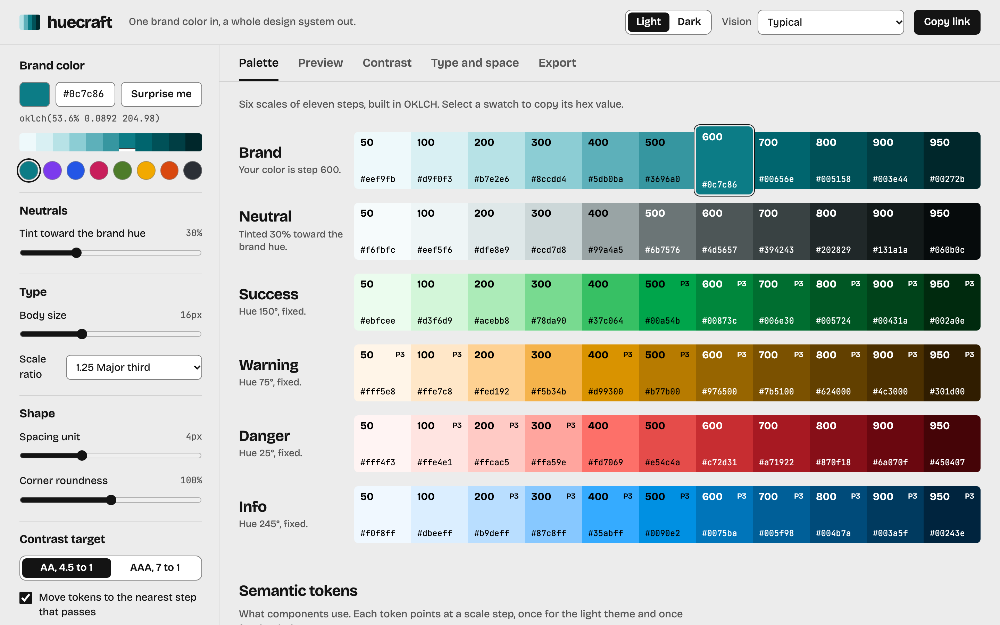
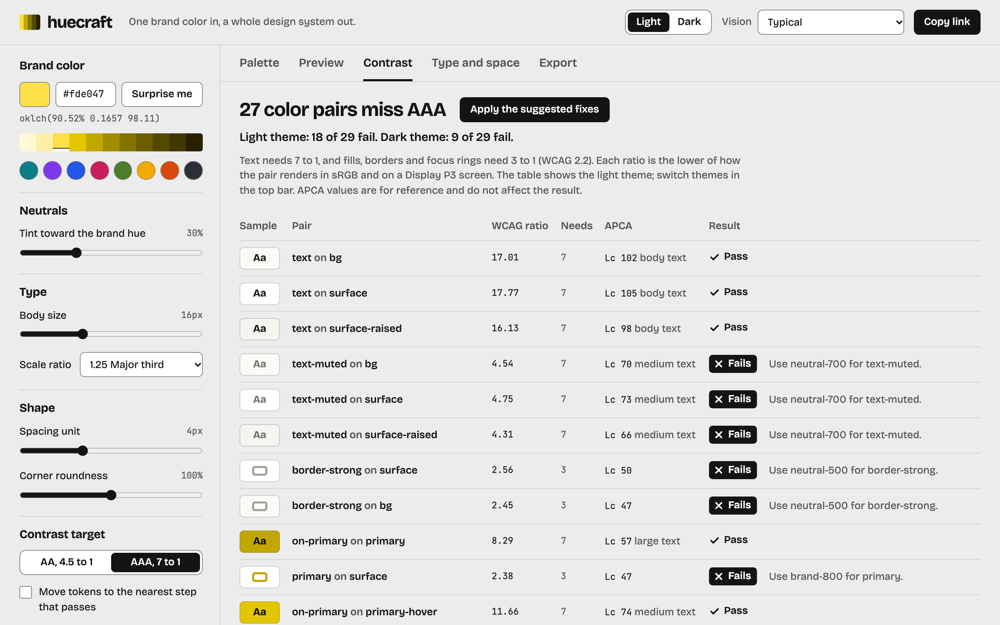
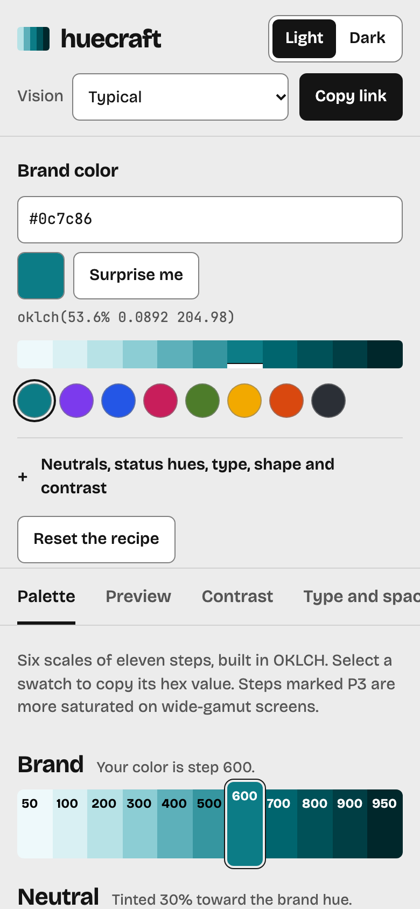
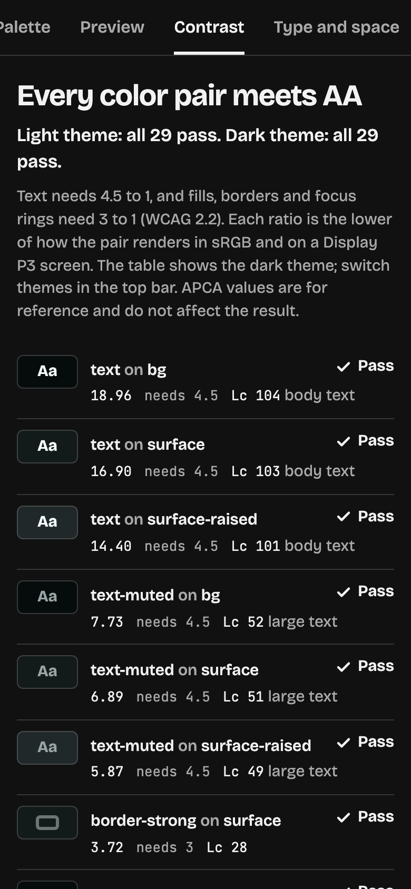

# huecraft

A design-token studio: pick one brand color and get a complete, accessible design system.
It runs in the browser, and the same generator ships as a small CLI.



## Quickstart

You need Node.js 22.18 or newer.

```bash
git clone https://github.com/Habibeyilmazz/huecraft.git
cd huecraft
npm ci
npm run dev
```

Open http://localhost:4140. Change the brand color and everything follows. The color field takes hex, `rgb()` or
`oklch()`.

The CLI prints the same tokens to stdout:

```bash
node dist-cli/cli.js 7c3aed --format css > tokens.css     # inside the clone, after npm ci
npx github:Habibeyilmazz/huecraft 7c3aed --format tailwind  # anywhere; builds from source on first run
```

Write the color without `#`, or quote it (`'#7c3aed'`), because an unquoted `#` starts a comment in most shells.
`'rgb(124 58 237)'` and `'oklch(0.54 0.25 293)'` work too, quoted.

Got a link from someone who tuned the palette in the studio? Pass it to the CLI in quotes instead of a color; its
recipe is used, and any option you add overrides it:

```bash
node dist-cli/cli.js 'http://localhost:4140/?b=7c3aed&t=0.5&lv=AAA&th=dark' --format scss > _tokens.scss
```

"Copy command" in the studio's Export tab goes the other way: it copies the `npx` call that writes the export on
screen to a file, ready for a build script.
Run `node dist-cli/cli.js --help` for every option. huecraft is not published to npm.

## What you get

- **Color scales.** Brand, neutral, success, warning, danger and info, eleven steps each (50 to 950), built in OKLCH.
  The brand scale keeps your exact color at the step nearest its lightness. Neutrals are tinted toward the brand hue
  by an amount you choose.
- **Status hues you can move.** Success, warning, danger and info start at 150°, 75°, 25° and 245° (OKLCH). When a
  status lands within 30° of your brand's hue or of another status (a red brand and danger, a blue brand and info),
  the studio says so under the sliders and on the palette, and the CLI prints a note on stderr. Drag the hue away
  and the scale, its semantic tokens and their contrast fixes follow.
- **sRGB and Display P3.** Every step is gamut-mapped by lowering chroma only, so lightness and hue hold. Where P3 can
  show more chroma than sRGB, the CSS export adds an `oklch()` override inside `@media (color-gamut: p3)`.
- **Semantic tokens for light and dark themes.** Backgrounds, surfaces, borders, text, a primary role and four status
  roles, each pointing at a scale step.
- **Contrast built in.** Each token is moved to the nearest step that reaches your target (WCAG 2.2 AA or AAA for text,
  3 to 1 for fills, borders and focus rings). The Contrast tab lists every checked pair with its WCAG ratio and APCA
  Lc value, shows what was moved, and has a step-by-step matrix for any two scales. Turn the fixing off to see what
  fails and what huecraft suggests.
- **Type, space, radius and shadow scales.** A modular type scale with fluid `clamp()` sizes, a spacing scale from one
  unit, a radius scale with one roundness control, and five layered shadows per theme.
- **Live preview.** A dashboard, a table, a form with an error state, buttons, badges, alerts and an article, styled
  only by the CSS variables you export. Light and dark switch instantly.
- **Color-vision simulation.** View the whole studio as someone with protanopia, deuteranopia, tritanopia or
  achromatopsia would.
- **Exports.** CSS custom properties, a Tailwind CSS v4 `@theme`, W3C design-tokens JSON, a Figma variables payload
  and SCSS maps. Copy or download, or copy the CLI command that writes the same file. Shadows are in every format
  except the Figma payload.
- **Shareable links.** The whole state lives in the URL query string. "Copy link" gives you a link that reopens the
  same palette, theme and tab.

| Light preview | Dark preview |
| --- | --- |
|  |  |

| Contrast check with fixing off | Deuteranopia simulation |
| --- | --- |
|  |  |

The studio works on a phone and without a mouse. Where a table has no room for its columns, each row turns into a
small stacked block instead of scrolling sideways. Tab reaches each color scale once, and the arrow keys, Home and
End move along its swatches. Motion is cut for people who ask for less of it, and Windows contrast themes keep the
swatches and the selected states. An axe audit of every tab in both themes runs in CI.

<p>
  
  
</p>

## CLI

```text
huecraft <color> [options]
huecraft <studio link> [options]

  <color>            7c3aed, '#7c3aed', 'rgb(124 58 237)' or 'oklch(0.54 0.25 293)'
  <studio link>      a link from the studio's "Copy link", or just its ?query part, in quotes;
                     its recipe is used and any option below overrides it
  -f, --format <f>   css | tailwind | json | figma | scss   (default: css)
      --tint <n>     neutral tint toward the brand hue, 0..1   (default: 0.3)
      --ratio <n>    type scale ratio: 1.067, 1.125, 1.2, 1.25, 1.333, 1.414, 1.5   (default: 1.25)
      --base <px>    body text size, 14..20   (default: 16)
      --unit <px>    spacing unit, 3..6   (default: 4)
      --radius <n>   corner roundness, 0..2   (default: 1)
      --level <l>    WCAG contrast target, AA | AAA   (default: AA)
      --success-hue <deg>, --warning-hue <deg>, --danger-hue <deg>, --info-hue <deg>
                     OKLCH hue of a status scale, 0..360
                     (defaults: success 150, warning 75, danger 25, info 245)
      --no-fix       keep preferred steps even where they miss the contrast target
      --fix          turn fixing back on when a studio link says fx=0
```

The CSS, Tailwind and SCSS output starts with a comment holding the command that recreates it; the design-tokens
JSON has it in `$description`. The Figma payload carries no such note, because it is a request body.
A link is read for its recipe only (theme, tab and vision settings are ignored) and must contain a brand color
(`b=`); fields it leaves out take their defaults, as in the studio. Invalid input exits with code 2 and a message
on stderr. A status hue within 30° of the brand or of another status prints a note on stderr and still exits 0, so
the output can be redirected as usual.

## How it works

Everything that computes tokens lives in `src/core` and has no dependencies. The web app (`src/app`) and the CLI
(`src/cli.ts`) both call it, so they cannot disagree.

| File | Job |
| --- | --- |
| `core/color.ts` | sRGB, Display P3 and OKLCH conversion, gamut mapping, WCAG 2 contrast, APCA Lc, color-vision matrices |
| `core/scales.ts` | The six 11-step scales |
| `core/semantic.ts` | Light and dark semantic tokens, the contrast walk, the list of checked pairs |
| `core/dimensions.ts` | Fluid type scale, spacing, radius |
| `core/tokens.ts` | The recipe (validated at the URL and CLI boundaries) and the full token set |
| `core/export.ts` | The five output formats |

Some decisions worth knowing:

- **One lightness curve for all chromatic scales.** Step 600 of success is about as light as step 600 of danger, so
  contrast is predictable across hues. The brand scale stretches that curve just enough to land your color exactly on
  one step.
- **Contrast by walking the scale.** Each semantic token has a preferred step. If it misses its target against the
  backgrounds it is used on, huecraft walks toward the dark end (light theme) or the light end (dark theme) until it
  passes. Wide-gamut screens show slightly different colors, so a step only counts as passing if its P3 override
  passes too. A unit test checks that every pair passes for 47 brand colors, both themes and both levels.
- **The studio uses its own output.** The page is styled by the same CSS string the Export tab shows. The studio's own
  chrome is deliberately grey, so the only colors on screen are yours.
- **Vision simulation** uses the Machado, Oliveira and Fernandes (2009) matrices at full severity, applied as an SVG
  filter in linear RGB.

### Limits

- Semantic pairs are checked twice, with the sRGB values and with the P3 overrides, and the lower ratio is reported.
  The step-by-step matrix uses the sRGB values only.
- APCA values are shown for reference only. Pass and fail are decided by WCAG 2.2 ratios.
- The brand color is stored as sRGB hex. An `oklch()` color that sRGB cannot show loses chroma until it fits; the
  readout under the color field shows what you ended up with. Display P3 is used for the generated steps, not for
  the brand color itself.
- The Figma export follows the request body of `POST /v1/files/:file_key/variables`. It has not been sent to a live
  Figma file, and Figma offers that endpoint on Enterprise plans only. Shadows and fluid sizes cannot be Figma
  variables, so they are left out or flattened to desktop sizes.
- In the Tailwind export, shadow utilities keep the light-theme shadows, because Tailwind inlines shadow values.
- Status hues are not moved for you. huecraft flags a status within 30° of the brand or of another status, but
  which one to move, and where, is your call. The 30° line is a rule of thumb, not a perceptual measure.
- Simulated color vision is an approximation and does not replace testing with people.

## How it compares

huecraft is a generator that goes from one color to a whole token set. It is young and has one maintainer, so be
clear about when another tool is the better pick.

| If you want | Use | Why not huecraft |
| --- | --- | --- |
| A hand-tuned scale for one color, with a large community behind it | [Radix Colors](https://www.radix-ui.com/colors) | Radix scales are designed by hand and battle-tested; huecraft's are computed |
| Tailwind's own palette and the default `@theme` | [Tailwind CSS](https://tailwindcss.com) | huecraft only helps when you want a palette from your brand color |
| A color-system editor with team features and Figma plugins | [Leonardo](https://leonardocolor.io), [Material Theme Builder](https://material-foundation.github.io/material-theme-builder/) | huecraft has no accounts, plugin or live Figma sync |
| Transforming token files into many platforms | [Style Dictionary](https://styledictionary.com) | huecraft writes five formats, not iOS or Android |
| Free-form OKLCH exploration | [oklch.com](https://oklch.com) | huecraft is opinionated: scales, semantic tokens and contrast fixing, not a picker |

Where huecraft fits: you have one brand color and want light and dark semantic tokens that already pass your
contrast target, type, spacing and shadow scales, and a link you can send someone.

## Development

```bash
npm run dev         # studio with hot reload on port 4140
npm run typecheck   # tsc, strict
npm test            # unit tests (node:test, runs the TypeScript directly)
npm run build       # production build in dist/
npm run e2e         # Playwright + axe against the build (run "npm run build" first)
```

`npm run e2e` needs Chromium for Playwright: `npx playwright install chromium`. Add `-- --shots` to refresh the
screenshots in `docs/screenshots/`.

To publish the studio, enable GitHub Pages for the repository with "GitHub Actions" as the source, then start the
"Deploy to GitHub Pages" workflow by hand from the Actions tab. It never runs on its own.

## Roadmap

- A brand color outside sRGB (Display P3 input)
- Per-token overrides in the studio
- Font family choices and line-height tokens
- Importing an existing palette
- More export targets (Style Dictionary, iOS, Android)
- A published npm package

## Contributing

Issues and pull requests are welcome. See [CONTRIBUTING.md](CONTRIBUTING.md).

## License

[MIT](LICENSE)
